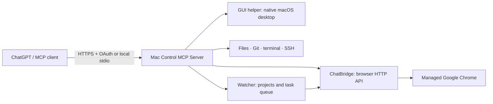

[**English**](README.md) · [Русский](README.ru.md)

# Mac Control MCP Server — macOS automation over MCP

**A macOS MCP server for ChatGPT and compatible AI clients.** Mac Control combines native desktop automation, files, terminal sessions, Git, SSH, ChatBridge browser automation and Watcher coordination across ChatGPT conversations.

Mac Control MCP Server is an experimental Model Context Protocol (MCP) server designed for autonomous tasks. It offers powerful control of the owner's Mac, not a restrictive sandbox.

> **Beta release.** The owner confirmed installation and connection on another Mac. Automated Watcher migration tests pass; real notification delivery after upgrading remains a separate acceptance step. This is experimental software.


## Start here

- [Capabilities and use cases](#capabilities-and-use-cases).
- [Mac Control modules](#mac-control-modules) and the [detailed capability guide](docs/CAPABILITIES.md).
- [Complete MCP tool reference](docs/TOOLS.md): purpose, prerequisites and read/write behavior.
- [macOS installation](#installation-macos), [remote access](docs/REMOTE_ACCESS_GUIDE.md) and [OAuth setup](docs/GITHUB_OAUTH_SETUP.md).
- [Watcher: first project and example prompts](docs/WATCHER_GUIDE.md).
- [Installation contents](docs/INSTALL_CONTENTS.md), [mclog audit viewer](docs/MCLOG.md) and [security](SECURITY.md).
- [Frequently asked questions](#frequently-asked-questions).

## Capabilities and use cases

Mac Control MCP Server exposes Model Context Protocol tools for owner-authorized
AI agents on a Mac. Agents can inspect data, work in approved projects and perform
authorized actions through an MCP client. ChatGPT connects through authenticated
remote HTTPS/OAuth; local MCP clients can use stdio.

Example requests after configuring the relevant modules:

- **Projects and files:** “Create a project in the workspace, inspect its sources and prepare changes using SHA256 checks.”
- **Git:** “Show repository status and diffs; commit or publish only when I request it.”
- **Terminal:** “Run the approved check in a terminal session, read the result and close it.”
- **macOS desktop:** “Find the application window, inspect its accessible controls and capture a screenshot.”
- **Browser:** “Open a page in a background session, inspect its structure and save the findings.”
- **SSH:** “Check the configured server using its approved connection profile.”
- **Multiple chats:** “Split this research into executor tasks and collect reports through Watcher.”
- **Delayed checks:** “In 15 minutes, check the result and report in this conversation using Watcher.”
- **Diagnostics:** “Show recent tool failures and Mac Control service status.”

The full configuration with GUI, ChatBridge and Watcher exposes **122 MCP tools**.
Registration does not replace setup: SSH needs profiles, terminal requires opt-in,
GUI needs macOS permissions and Watcher needs registered tasks.
[Full English tool catalog](docs/TOOLS.md) · [Каталог на русском](docs/TOOLS.ru.md).

## Mac Control modules

| Module | Capabilities | Prerequisites |
|---|---|---|
| **Files and projects** | Directory listing, search, reads, writes, SHA256 checks, backups and recovery. | Workspace or explicitly approved project roots. |
| **Git** | Status, history, diffs, branches, staging, commits, fetch/pull/push. | An approved project repository and owner credentials for remote Git. |
| **Terminal** | Persistent PTY sessions, input/output, resize and close. | Explicit local terminal policy opt-in and tmux. |
| **SSH** | Host profiles, authentication diagnostics, fixed checks, managed remote commands and PTYs. | Approved profiles, owner keys, known_hosts and applicable policy. |
| **GUI helper** | Windows/displays, Accessibility tree, screenshots, mouse, keyboard and Unicode input. | Installed app and owner-approved Accessibility/Screen Recording. |
| **ChatBridge browser** | Background sessions, navigation, element actions, DOM snapshots, screenshots and session lifecycle. | Separate ChatBridge and Google Chrome; the owner signs in to sites. |
| **ChatGPT conversations** | Create, switch, read, send and wait for responses through the browser adapter. | ChatGPT login in ChatBridge's profile and a working web integration. |
| **Watcher** | Project coordination, executor reports, continuation, delayed checks and delivery acknowledgements. | ChatBridge, exact registered conversations and a running Mac. |
| **System, services and packages** | Machine/port health, approved commands, service checks/restart and controlled package installation. | Owner-managed allowlists; a package manager when required by the selected action. |
| **MCP bridge** | Access separately configured downstream MCP servers. | Target configuration, dependencies and authentication. |
| **Audit and maintenance** | Invocation metadata, audit search, service logs, diagnostics and owned server restart. | Installed Mac Control; audit omits message and file contents. |
| **Installer and remote access** | Isolated Python, prebuilt GUI, updates/rollback, GitHub OAuth, HTTPS and Tailscale Funnel. | Owner action for accounts, permissions and public HTTPS publication. |

[Detailed module behavior, limitations and examples](docs/CAPABILITIES.md).
Experimental `background_app_*` tools are not part of the standard beta.16 set.

## How Mac Control, ChatBridge and Watcher fit together



Mac Control exposes MCP tools. ChatBridge is a separate product and the browser's
owner. Watcher persists task state and routes results between exact conversations.
The GUI helper controls native macOS interfaces under its own permissions.
These components do not share a universal session or substitute for each other's
account authentication.

## ChatBridge is independent

**ChatBridge is a separate application and repository.** It exposes an authorized ChatGPT web session and browser automation through HTTP. It works without Mac Control.

The default Mac Control installer **automatically provisions ChatBridge** from its
SHA256-pinned `v0.2.0-beta.11` release when absent, with independent application,
Chrome profile, SQLite state and its installer source under `~/MacControlMCP/deps/`.
An existing ChatBridge is reused **only when already installed within that root**.
A foreign standalone installation must be removed or relocated before consolidation.
ChatBridge retains its own HTTP API and LaunchAgent. Plain `uninstall` preserves
the dependency; `uninstall --all` stops and removes the owned dependency as well.
Use `--without-chatbridge` for Mac Control without browser features.

**ChatBridge source:** [johnnykor82/chatbridge](https://github.com/johnnykor82/chatbridge).
Use a reviewed published release of ChatBridge.

## Installation (macOS)

Requires macOS, Python 3.9+ for bootstrap, Google Chrome and a compatible MCP client. Native helpers require macOS 14+ on Apple Silicon or Intel. The installer provisions isolated Python 3.13 using [uv](https://docs.astral.sh/uv/). Review the source first.

```sh
mkdir -p "$HOME/MacControlMCP"
git clone https://github.com/johnnykor82/mac-control-mcp-server.git "$HOME/MacControlMCP/source"
python3 "$HOME/MacControlMCP/source/scripts/release_preflight.py" --json || [ "$?" -eq 2 ]
python3 "$HOME/MacControlMCP/source/scripts/release_audit.py" --strict
python3 "$HOME/MacControlMCP/source/scripts/install_mac_control.py" --plan
python3 "$HOME/MacControlMCP/source/scripts/install_mac_control.py" --install
"$HOME/MacControlMCP/bin/maccontrol" status
```

### Managing a consolidated installation

All Mac Control-owned files live in **`~/MacControlMCP`**: `source/` for the
initial checkout, versioned `releases/`, `current`, `previous`, `apps/`
for the native GUI, `data/` for workspace, configuration, logs and backups,
`deps/` for managed ChatBridge, and the `bin/maccontrol` launcher.

Run these commands from **any working directory**. Updating downloads the latest
published GitHub beta with its SHA256SUMS, validates the archive, and activates
the new release. No source checkout or `git pull` is required for updates:

```sh
"$HOME/MacControlMCP/bin/maccontrol" update
"$HOME/MacControlMCP/bin/maccontrol" status
"$HOME/MacControlMCP/bin/maccontrol" rollback
"$HOME/MacControlMCP/bin/maccontrol" uninstall       # preserve data
"$HOME/MacControlMCP/bin/maccontrol" uninstall --all # erase all (type DELETE)
```

Complete removal stops and removes Mac Control's own LaunchAgents and its
**managed ChatBridge dependency** (service, application, Chrome profile and data).
A plain `uninstall` leaves ChatBridge and user data in place. **Tailscale remains
unchanged**. macOS privacy permissions remain under
System Settings. Existing legacy installations are not automatically migrated:
uninstall the old installation through its original installer, then install this
new layout from scratch.

Run `--install` in Terminal. It checks the local ChatBridge API first. If absent,
it downloads the pinned release, checks SHA256 before extracting or executing,
and runs ChatBridge's own installer. Existing state, LaunchAgent, occupied port,
HTTP 401 or incompatible API stop setup for independent recovery; nothing is
silently overwritten. ChatBridge requires Google Chrome. If `uv` is absent, its
installer offers the official standalone installation without Homebrew, with your consent; if Astral is unavailable, it tries the official GitHub release. It selects uv for the Mac's architecture; Python 3.9+ bootstraps the
isolated Python 3.13 runtime. For standalone mode or a reused service without uv,
install [uv](https://docs.astral.sh/uv/getting-started/installation/) first.
Preflight reports missing uv until it is installed; this does not prevent the
default interactive ChatBridge bootstrap from offering it.

Default origin: `http://127.0.0.1:8787`; use `--chatbridge-url http://127.0.0.1:PORT`
for another local port. `--with-chatbridge` remains accepted; advanced owners can
provide `--chatbridge-source PATH` only for a reviewed source already placed
at `~/MacControlMCP/deps/chatbridge-source`. No separate ChatBridge installation is required.
No API key is required by default. If ChatBridge has `CHATBRIDGE_API_KEY`, set a
matching `MACCONTROL_CHATBRIDGE_API_KEY` in installer and MCP client environments.
Never paste keys into chat or command arguments.

After an interactive installation, ChatBridge checks the saved ChatGPT session
once the browser is ready. If it cannot confirm the session, it offers to open
the managed profile for a manual check. If you skip
the offer, first run `curl -fsS -X POST http://127.0.0.1:8787/v1/browser/wake`,
then wait until `curl http://127.0.0.1:8787/v1/system/status` reports
`browser.mode=managed` and `browser.state=running`, then open the **default profile only**:

```sh
"/Applications/Google Chrome.app/Contents/MacOS/Google Chrome" --user-data-dir="$HOME/MacControlMCP/deps/chatbridge-data/chrome-profile" --new-window https://chatgpt.com/
```

For custom profile locations follow ChatBridge's instructions. Opening a login
window does not verify a real ChatGPT login. If Mac Control
fails later, ChatBridge remains installed independently; rerunning reuses its
working compatible API. The dependency setup timeout is 30 minutes; after timeout
inspect ChatBridge status before retrying.

After five minutes without browser operations, ChatBridge stops its own Chrome;
the next browser operation starts it again. Profile data is preserved.
During idle, `/ready` returns HTTP 503 with `reason=browser_idle` without waking
Chrome. If API authentication is enabled, use an authenticated client for wake
and status checks.

Default `--install` installs the GUI helper under
`~/MacControlMCP/apps/MacControlMCPServer.app`, or reuses the verified helper owned by
this installation. It downloads prebuilt universal GUI and Unicode clipboard
helpers from the pinned release and verifies SHA256 before extraction. Normal
installation does not compile helpers or require Apple Command Line Tools.
The binaries are ad hoc signed, without a Developer ID signature or Apple
notarization; the signature verifies integrity, not publisher identity.
Manual developer builds with `scripts/build_mac_control_gui.py` or
`scripts/package_gui_release.py` still require Apple developer tools and Swift.

After local installation, the interactive setup starts the helper and requests
missing Accessibility and Screen Recording permissions in order, checking each
grant before proceeding. A system popup is not guaranteed; use the Settings
instructions if it does not appear. Only the owner grants these macOS permissions.
It continues through public HTTPS selection, GitHub
OAuth, owner login autostart and public endpoint checks. The owner manually
adds the plugin in ChatGPT and completes real OAuth login. Noninteractive
installation reports `pending_owner_interaction`.

Resume setup in Terminal:

```sh
python3 scripts/install_mac_control.py --setup
```
Interactive installation and setup offer English or Russian and suggest the macOS language. Use `--language en` or `--language ru` to select explicitly. Third-party installer output may remain in its original language.


`--update` reuses the verified GUI app without replacing it, preserving its TCC
identity; it does not rerun the wizard. Resume with `--setup` as needed.
`--with-gui` explicitly replaces the verified owner-managed app from the pinned
prebuilt release and may require new TCC approval. `--without-gui` skips new GUI installation and
the wizard's TCC step; an already enabled GUI remains configured and its
clipboard helper is prepared in the new release. After choosing this option, resume with `--setup --without-gui`. Unknown apps are never
replaced. `--rollback` and `--uninstall` preserve user data. A local MCP client
runs the installed `bin/mac-control-stdio-mcp.sh` launcher.

## Dedicated agent workspace

Agent-created files, clones, temporary outputs, downloads and artifacts belong in:

`~/MacControlMCP/data/workspace`

This is conveyed by MCP server instructions and the `workspace_policy` tool. Writing elsewhere requires an explicit owner instruction or necessary OS-specific service setup. **It is a behavioral convention, not an OS-enforced sandbox.**

See [workspace rules](AGENT_WORKSPACE_POLICY.md) and [installation contents](docs/INSTALL_CONTENTS.md).

## mclog — live audit monitor

**`mclog` ships with Mac Control MCP Server.** It is a read-only,
interactive terminal dashboard for MCP tool invocations: requests, errors,
running calls, average execution time, hourly activity and a scrollable
history. Press `e` to filter errors, arrows / Page Up / Page Down to
scroll, and `q` to exit.

After installing Mac Control, launch it from a separate terminal:

```sh
"$HOME/MacControlMCP/current/bin/mclog"
```

The bundled executable automatically reads
`~/MacControlMCP/data/logs/audit.jsonl*`.
Use `--log-dir PATH` to inspect another authorized audit directory.
For privacy, the public installer stores **tool names, times, statuses and
execution durations only**, not command arguments, file contents, responses
or credentials. The standalone viewer needs no connection to ChatBridge.
See [mclog usage](docs/MCLOG.md).

## GitHub OAuth and public HTTPS

The [ChatGPT setup guide](docs/CHATGPT_SETUP.ru.md) is available in Russian.

The `--setup` wizard requests TCC, checks network signals and asks whether the
owner has a public IP with incoming HTTPS. Direct access requires a domain,
trusted TLS certificate, external TCP 443 and an owner-configured reverse proxy
to `127.0.0.1:3201`. Never expose port 3201 externally. IP echo cannot prove
inbound reachability; verify HTTPS from another network. Without a known public
IP, the wizard offers Tailscale Funnel and reuses an existing client. The owner
completes login, macOS networking and tailnet approvals.

Once the final HTTPS origin is selected, the owner creates a personal GitHub
OAuth App and enters its Client Secret through hidden local input. The wizard
installs the owner-scoped `org.maccontrol.mcpserver.remote` LaunchAgent for
login autostart, starts authenticated MCP, and checks the local 401 and issuer.
Funnel requires separate `PUBLISH` confirmation and preserves unrelated
published routes. A public probe follows. VPN, WireGuard and Exit Node routing
are not changed.

A passing probe alone does not verify real OAuth or ChatGPT connectivity.
The owner confirmed a base connection on another Mac; each installation still
needs its own real login and tool test, including Watcher delivery after upgrade.
See [OAuth setup](docs/GITHUB_OAUTH_SETUP.md), [network setup](docs/REMOTE_ACCESS_GUIDE.md) and [agent instructions](AGENT_INSTALL.md).

## Security, status and license

An agent authorized to use shell, GUI and network tools can delete or disclose data and make consequential changes. It is not isolated by a security sandbox. See [SECURITY.md](SECURITY.md). ChatBridge is unofficial and depends on a changing web UI, not the official OpenAI API.

**License: MIT.** Copyright © 2026 Ivan Konstantinov. See [LICENSE](LICENSE). Beta releases include source checks and automated tests; validate the workflows you intend to use on your own Mac. See [release gates](docs/PUBLIC_RELEASE_GATES.md).

## Watcher and maintenance tools (beta.16)

Use Watcher when one conversation coordinates research or development while
other conversations execute individual tasks. It delivers reports, questions
and blocked-work notices to the coordinator. It can also schedule a later check
or continue work in an existing executor conversation.

**[Step-by-step guide with example prompts](docs/WATCHER_GUIDE.md)**: first project,
file and browser tasks, delayed checks, project pause and troubleshooting.

Default installation with ChatBridge now provisions Watcher and its user login
LaunchAgent `org.maccontrol.mcpserver.watcher`. It reuses the installed Mac Control
Python; ChatBridge is the sole browser owner. Watcher does not contact ChatGPT
while idle. Delivery requires signing in to ChatGPT in the ChatBridge profile.
New installations start with no projects, tasks or migrated credentials.

After connecting MCP, call `watcher_guide` and `watcher_status`. Use exact project
and executor chat URLs; the guide explains file reports, continuation in the same
chat, and scheduled checks. State remains under the private Mac Control data root.

```bash
# Existing standard installation
git pull --ff-only
python3 scripts/install_mac_control.py --update
# Read-only service check
python3 scripts/setup_watcher_service.py --status
```

`--without-watcher` skips provisioning and stops its owned service;
`--without-chatbridge` preserves existing configuration without provisioning Watcher.
Updates restart only owned services. Uninstall preserves state. Rolling back to
pre-beta.16 stops Watcher because that release has no runtime.

Maintenance tools include `audit_tail`, `audit_search`, `list_workspace`,
`process_snapshot`, `read_service_log`, `mcp_diagnostics`, `read_file`, `write_file`,
`restart_server`, `custom_query`, and `custom_command`. Dispatch is limited to
shipped operations; workspace Python is never dynamically imported. File aliases
are workspace-scoped; explicitly listed shipped sources are read-only. Replacing
files requires their current SHA256. Audit logs retain metadata only.

An older customized server requires a separate configuration migration. Never
publish its secrets, Watcher database or browser profiles.

## Frequently asked questions

### Can ChatGPT control my Mac?

Yes, through a configured MCP connection with HTTPS and OAuth. Installing the
software alone does not add the ChatGPT connector: the owner completes connection
setup and login. Available actions depend on tools, local configuration and permissions.

### Does it support Apple Silicon and Intel Macs?

The prebuilt GUI helper supports arm64 and x86_64 on macOS 14+. The installer uses
an isolated Python 3.13 managed by uv; launching it requires Python 3.9+.
Normal installation does not compile the helper or build Rust/LLVM through
Homebrew. Cloning requires Git; release source archives are also available.

### Are ChatBridge and Watcher installed automatically?

Yes, default installation provisions both, and installs the GUI helper. Watcher
reuses Mac Control's Python environment. Developer accounts, ChatGPT login, macOS
permissions, SSH profiles and Watcher projects are not copied to a fresh Mac.

### Can I use it without ChatGPT or a browser?

A local MCP client can use stdio. Files, Git, system tools and configured
terminal/SSH do not depend on ChatGPT login. `--without-chatbridge` skips dependency
setup while preserving existing configuration. Browser tasks and Watcher ChatGPT
notifications require ChatBridge.

### Is this the official OpenAI API?

No. MCP is the tool interface; ChatBridge integrates with the ChatGPT website
through a browser. This path does not require a separate OpenAI API key, but
account availability, website behavior and provider limits still apply.

### Does Watcher run while my Mac sleeps?

No. Delivery requires the Mac to be running and logged in to macOS. State survives
restarts, but work resumes only once service access returns. Watcher is neither
an independent cloud service nor an additional AI model.

### Where are projects and state stored?

By default under `~/MacControlMCP/data/`.
Agent projects use `data/workspace/`; Watcher state uses `data/run/watcher/`.
Updates retain data. Older customized servers require a separate configuration
migration. Never publish credentials or browser profiles in a public repository.

### How stable is this release?

This is beta software. Beta.16 passed 388 local tests and GitHub CI. The owner
confirmed base installation and connection on another Mac; real delivery of the
new Watcher remains a post-upgrade acceptance test. ChatGPT website changes,
account limits and network settings can affect operation.
