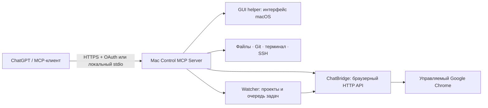

[English](README.md) · [**Русский**](README.ru.md)

# Mac Control MCP Server — управление macOS через MCP

**MCP-сервер для управления Mac из ChatGPT и совместимых ИИ-клиентов.** Mac Control объединяет автоматизацию интерфейса macOS, файлы, терминал, Git, SSH, фоновый браузер через ChatBridge и Watcher для координации задач между чатами.

Mac Control MCP Server — экспериментальный сервер Model Context Protocol (MCP) для автономных задач. Он предоставляет агенту широкие полномочия на Mac владельца, а не ограничивающую песочницу.

> **Бета-версия.** Владелец подтвердил установку и подключение на другом Mac. Автоматические проверки переноса Watcher пройдены; реальную доставку его уведомлений после обновления ещё предстоит проверить. Это экспериментальный релиз.


## С чего начать

- [Возможности и сценарии применения](#возможности-и-сценарии-применения).
- [Модули Mac Control](#модули-mac-control) и [подробный обзор каждого модуля](docs/CAPABILITIES.ru.md).
- [Каталог MCP-инструментов](docs/TOOLS.ru.md): назначение, условия работы, чтение и изменения.
- [Установка на macOS](#установка-на-macos) и [подключение ChatGPT](docs/CHATGPT_SETUP.ru.md).
- [Watcher: первый проект и примеры запросов](docs/WATCHER_GUIDE.ru.md).
- [Что устанавливается](docs/INSTALL_CONTENTS.md), [аудит и mclog](docs/MCLOG.md), [безопасность](SECURITY.md).
- [Частые вопросы](#частые-вопросы).

## Возможности и сценарии применения

Mac Control MCP Server предоставляет инструменты Model Context Protocol для
авторизованного ИИ-агента на вашем Mac. Агент может читать данные, работать
с разрешёнными проектами и выполнять согласованные действия через MCP-клиент.
Для ChatGPT предусмотрен удалённый HTTPS/OAuth-сервер; для локальных клиентов — stdio.

Примеры запросов после настройки соответствующих модулей:

- **Работа с проектом:** «Создай проект в рабочем каталоге, изучи исходники и подготовь изменения с проверкой SHA256».
- **Git:** «Покажи состояние репозитория и изменения; коммит и публикацию выполняй только по моему указанию».
- **Терминал:** «Запусти разрешённую проверку в сессии терминала, прочитай результат и закрой сессию».
- **GUI macOS:** «Найди окно приложения, прочитай доступные элементы и сделай скриншот».
- **Браузер:** «Открой страницу в фоновой сессии, изучи её структуру и сохрани результат».
- **SSH:** «Проверь состояние настроенного сервера по разрешённому профилю».
- **Несколько чатов:** «Раздели исследование на задачи исполнителям и собери отчёты через Watcher».
- **Отложенная проверка:** «Через 15 минут проверь результат и сообщи в этот чат через Watcher».
- **Диагностика:** «Покажи последние ошибки инструментов и состояние служб Mac Control».

В полной конфигурации с GUI, ChatBridge и Watcher доступны **122 MCP-инструмента**.
Наличие инструмента в каталоге не заменяет его настройку: SSH требует профилей,
терминал — включения политики, GUI — разрешений macOS, Watcher — регистрации задач.
[Полный каталог на русском](docs/TOOLS.ru.md) · [English tool reference](docs/TOOLS.md).

## Модули Mac Control

| Модуль | Возможности | Что требуется |
|---|---|---|
| **Файлы и проекты** | Список каталогов, поиск, чтение, создание и замена файлов, контроль SHA256, резервные копии и восстановление. | Рабочий каталог или явно разрешённые корни проектов. |
| **Git** | Статус, история, diff, ветки, подготовка и создание коммитов, fetch/pull/push. | Репозиторий в разрешённом проекте и учётные данные владельца для удалённого Git. |
| **Терминал** | Постоянные PTY-сессии, отправка ввода, чтение вывода, изменение размера и закрытие. | Явное включение локальной политики и tmux. |
| **SSH** | Профили серверов, диагностика аутентификации, фиксированные проверки и управляемые удалённые команды/PTY. | Разрешённые профили, ключи владельца, known_hosts и соответствующая политика. |
| **GUI helper** | Окна и дисплеи, дерево Accessibility, скриншоты, мышь, клавиатура и ввод Unicode. | Установленное приложение и выданные владельцем Accessibility/Screen Recording. |
| **ChatBridge: браузер** | Фоновые сессии, переходы, действия с элементами, DOM, снимки экрана и жизненный цикл сессии. | Отдельный ChatBridge и Google Chrome; вход на сайты выполняет владелец. |
| **Чаты ChatGPT** | Создание, переключение, чтение, отправка и ожидание ответов через браузерный адаптер. | Вход в ChatGPT в профиле ChatBridge и доступная веб-интеграция. |
| **Watcher** | Координация проектов, отчёты исполнителей, продолжение задач, отложенные проверки и подтверждения доставки. | ChatBridge, зарегистрированные точные чаты и работающий Mac. |
| **Система, службы, пакеты** | Состояние компьютера и портов, разрешённые команды, проверка/перезапуск служб, контролируемая установка пакетов. | Настроенные списки разрешений; менеджер пакетов, если нужен выбранный сценарий. |
| **MCP-мост** | Обращение к отдельно настроенным MCP-серверам через разрешённые подключения. | Конфигурация целевых серверов и их собственные зависимости/авторизация. |
| **Аудит и обслуживание** | Метаданные вызовов, поиск ошибок, журналы служб, диагностика, перезапуск собственной службы. | Установленный Mac Control; аудит не хранит содержимое сообщений и файлов. |
| **Установка и удалённый доступ** | Изолированный Python, готовый GUI helper, обновление/откат, GitHub OAuth, HTTPS и Tailscale Funnel. | Действия владельца для аккаунтов, разрешений и публикации HTTPS. |

[Подробное описание модулей, ограничений и примеров](docs/CAPABILITIES.ru.md).
Экспериментальные `background_app_*` не входят в стандартный набор beta.16.

## Как связаны Mac Control, ChatBridge и Watcher



Mac Control предоставляет MCP-инструменты. ChatBridge — отдельный продукт,
который владеет браузером. Watcher хранит состояние и организует передачу
результатов между конкретными чатами. GUI helper отвечает за нативный интерфейс
Mac и имеет собственные разрешения macOS. Эти компоненты не являются одной
общей сессией и не заменяют друг другу авторизацию.

## ChatBridge — отдельный продукт

**ChatBridge имеет самостоятельную установку и репозиторий.** Он предоставляет HTTP-доступ к авторизованной браузерной сессии ChatGPT и фоновую автоматизацию браузера. Для его работы Mac Control не нужен.

Стандартный установщик Mac Control **автоматически устанавливает ChatBridge**
из проверенного SHA256-релиза `v0.2.0-beta.11`, если зависимость отсутствует.
Исходники установщика, приложение, база и профиль Chrome помещаются в
`~/MacControlMCP/deps/`. Уже запущенный ChatBridge переиспользуется, **только
если он установлен в эту папку**; другая установка требует отдельного удаления.
ChatBridge остаётся самостоятельным сервисом со своим LaunchAgent и HTTP API.
Обычное удаление Mac Control сохраняет его, а `uninstall --all` штатно
останавливает и удаляет также управляемую зависимость.
Для работы без браузера используйте `--without-chatbridge`.

**Исходники ChatBridge:** [johnnykor82/chatbridge](https://github.com/johnnykor82/chatbridge).
Используйте проверенный опубликованный релиз ChatBridge.

По умолчанию ChatBridge доступен по `http://127.0.0.1:8787` без API-ключа.
Для другого локального порта передайте установщику `--chatbridge-url
http://127.0.0.1:PORT`. Если владелец включил `CHATBRIDGE_API_KEY`, задайте
совпадающий `MACCONTROL_CHATBRIDGE_API_KEY` в окружении установщика и процесса
MCP-клиента. Не вставляйте ключ в чат или аргументы команд.

## Установка на macOS

Требуются macOS, Python 3.9+ для bootstrap, Google Chrome и совместимый MCP-клиент. Нативные helper требуют macOS 14+ на Apple Silicon или Intel. Установщик создаёт изолированный Python 3.13 через [uv](https://docs.astral.sh/uv/). Перед запуском изучите исходники.

```sh
mkdir -p "$HOME/MacControlMCP"
git clone https://github.com/johnnykor82/mac-control-mcp-server.git "$HOME/MacControlMCP/source"
python3 "$HOME/MacControlMCP/source/scripts/release_preflight.py" --json || [ "$?" -eq 2 ]
python3 "$HOME/MacControlMCP/source/scripts/release_audit.py" --strict
python3 "$HOME/MacControlMCP/source/scripts/install_mac_control.py" --plan
python3 "$HOME/MacControlMCP/source/scripts/install_mac_control.py" --install
"$HOME/MacControlMCP/bin/maccontrol" status
```

### Управление установленным Mac Control

Все собственные файлы Mac Control находятся в **`~/MacControlMCP`**:
`source/` (исходники первичной установки), `releases/` (версии Python),
`current`, `previous`, `apps/` (GUI), `data/` (настройки, рабочие файлы,
журналы и резервные копии), `deps/` (ChatBridge и его данные) и `bin/maccontrol`.

Команды работают **из любой папки** и больше не требуют `git pull`:
при обновлении выбирается последний опубликованный beta-релиз GitHub, скачиваются
архив и SHA256SUMS, проверяется контрольная сумма, затем устанавливается новая
версия с сохранением предыдущей для отката.

```sh
"$HOME/MacControlMCP/bin/maccontrol" update
"$HOME/MacControlMCP/bin/maccontrol" status
"$HOME/MacControlMCP/bin/maccontrol" rollback
"$HOME/MacControlMCP/bin/maccontrol" uninstall       # оставить данные
"$HOME/MacControlMCP/bin/maccontrol" uninstall --all # удалить всё, требуется ввод DELETE
```

Пользовательский Mac Control целиком удаляется через `uninstall --all`, включая
исходники `source`, GUI и рабочие данные. Установщик также останавливает и
удаляет зарегистрированные им службы Mac Control из `~/Library/LaunchAgents`.
`uninstall --all` удаляет также автоматически установленный ChatBridge:
сначала останавливает его LaunchAgent и Chrome, затем удаляет браузерный профиль,
базу данных и исходники из `deps/`. Обычное `uninstall` сохраняет данные и
зависимость. **Tailscale не удаляется и не перенастраивается**. Разрешения macOS
управляются в «Системных настройках».

Старые установки по пути `~/Library/Application Support/MacControl/MCPServer`
не переносятся автоматически: для новой структуры используйте чистую установку,
предварительно удалив прежнюю штатным установщиком старой версии.

Запускайте `--install` в Terminal. Установщик сначала проверяет API ChatBridge.
При отсутствии сервиса он скачивает закреплённый релиз, сверяет SHA256 до
распаковки и исполнения и вызывает собственный установщик ChatBridge.
Существующие данные, LaunchAgent, занятый порт, HTTP 401 или несовместимый API
останавливают настройку: сначала восстановите отдельный ChatBridge.
Нужен Google Chrome. Установщик выбирает `uv` с подходящей архитектурой. Если
он отсутствует, ChatBridge предлагает установить его с согласия владельца без
Homebrew: сначала из Astral, а при недоступности — из официального релиза GitHub.
Если оба источника недоступны, установщик выведет дальнейшие инструкции;
bootstrap работает на Python 3.9+ и создаёт отдельный
Python 3.13. При standalone-установке или переиспользовании сервиса без uv
сначала установите [uv](https://docs.astral.sh/uv/getting-started/installation/).
Preflight возвращает код 2, если uv ещё отсутствует; команда выше допускает этот
результат, чтобы интерактивный bootstrap ChatBridge мог предложить его установку.

`--with-chatbridge` сохранён для совместимости. Для явного
`--chatbridge-source PATH` источник должен лежать внутри
`~/MacControlMCP/deps/chatbridge-source`. Отдельно устанавливать ChatBridge
перед Mac Control **не нужно**. После новой интерактивной
установки ChatBridge проверит сохранённую сессию ChatGPT, когда браузер будет
готов. Если подтвердить её не удастся, он предложит открыть управляемый профиль
для ручной проверки. Если вы пропустили предложение,
запустите `curl -fsS -X POST http://127.0.0.1:8787/v1/browser/wake` и
дождитесь, пока `curl http://127.0.0.1:8787/v1/system/status` покажет
`browser.mode=managed` и `browser.state=running`, и откройте **только профиль по умолчанию**:

```sh
"/Applications/Google Chrome.app/Contents/MacOS/Google Chrome" --user-data-dir="$HOME/MacControlMCP/deps/chatbridge-data/chrome-profile" --new-window https://chatgpt.com/
```

Для другого расположения профиля следуйте инструкциям ChatBridge. Открытие окна
не подтверждает реальный вход в ChatGPT.
Через пять минут без операций ChatBridge остановит свой Chrome; следующий
браузерный запрос снова запустит его. Профиль и данные сохраняются.
В режиме простоя `/ready` возвращает HTTP 503 с `reason=browser_idle` и не
запускает браузер. Если включён API-ключ, используйте авторизованный клиент для
пробуждения и проверки состояния.
При последующей ошибке Mac Control ChatBridge остаётся отдельно установленным;
повторный запуск использует его совместимый работающий API. Лимит настройки —
30 минут; после таймаута сначала проверьте состояние ChatBridge.

Стандартный `--install` устанавливает GUI helper в
`~/MacControlMCP/apps/MacControlMCPServer.app` или переиспользует проверенный helper
этой установки. Он скачивает готовые universal GUI и Unicode clipboard helper
из закреплённого релиза и сверяет SHA256 до распаковки. Обычная установка не
компилирует helper и не требует Apple Command Line Tools. Бинарные файлы имеют
ad hoc подпись, без Developer ID и нотариализации Apple; такая подпись проверяет
целостность, но не личность издателя. Для ручной сборки разработчиком через
`scripts/build_mac_control_gui.py` или `scripts/package_gui_release.py`
по-прежнему нужны инструменты разработчика Apple и Swift.

После локальной установки интерактивный мастер последовательно запросит через
helper недостающие Accessibility и Screen Recording, проверяя каждое разрешение
перед переходом дальше. Системное окно может не появиться; в этом случае следуйте
инструкциям мастера для Settings. Разрешения выдаёт владелец в macOS.
Затем мастер проведёт через выбор публичного HTTPS, GitHub OAuth, автозапуск
remote MCP при входе владельца и проверку внешнего endpoint. Подключение plugin
в ChatGPT и реальный OAuth-вход владелец завершает вручную. При отсутствии
интерактивного Terminal настройка остаётся `pending_owner_interaction`.

Продолжить отложенную настройку:

```sh
python3 scripts/install_mac_control.py --setup
```
Интерактивная установка и мастер предлагают английский или русский язык, учитывая язык macOS. Можно указать `--language ru` или `--language en`. Вывод сторонних установщиков может оставаться на исходном языке.


`--update` по умолчанию сохраняет helper без замены, чтобы сохранить его
идентичность для TCC, и не запускает мастер заново; продолжите через `--setup`.
`--with-gui` явно заменяет только проверенный owner-managed helper готовым
приложением из закреплённого релиза;
macOS может запросить разрешения повторно. `--without-gui` пропускает новую
установку GUI и запрос TCC мастером; уже включённый GUI сохраняется, а clipboard
helper готовится для нового релиза. После этого варианта продолжайте настройку через `--setup --without-gui`. Неизвестный app установщик не заменяет.
Доступны `--rollback` и `--uninstall` с сохранением пользовательских данных.
Локальный MCP-клиент запускает установленный `bin/mac-control-stdio-mcp.sh`.

## Рабочий каталог агентов

Новые проекты, временные файлы, клоны репозиториев, загрузки и результаты по умолчанию создаются здесь:

`~/MacControlMCP/data/workspace`

Правило находится в инструкциях MCP-сервера и инструменте `workspace_policy`. Запись вне каталога — только по прямому указанию владельца или для необходимых системных настроек. **Это правило для агента, а не системная песочница.**

См. [правила workspace](AGENT_WORKSPACE_POLICY.md) и [состав установки](docs/INSTALL_CONTENTS.md).

## mclog — монитор аудита Mac Control

**`mclog` входит в установочный комплект Mac Control MCP Server.** Это
интерактивная терминальная панель для просмотра вызовов MCP: количества
запросов, ошибок, выполняющихся операций, средней длительности, почасовой
нагрузки и истории вызовов. Клавиша `e` включает фильтр ошибок,
стрелки / PgUp / PgDn прокручивают историю, `q` закрывает монитор.

После установки откройте отдельное окно терминала и запустите:

```sh
"$HOME/MacControlMCP/current/bin/mclog"
```

Утилита автоматически читает журнал
`~/MacControlMCP/data/logs/audit.jsonl*`.
Для просмотра другого разрешённого каталога есть параметр `--log-dir PATH`.
В целях безопасности релизный MCP сохраняет **названия инструментов, время,
статус и длительность выполнения**, но не аргументы команд, содержимое
файлов, ответы и секреты. ChatBridge для работы `mclog` не нужен.
Подробности: [инструкция mclog](docs/MCLOG.md).

## GitHub OAuth и публичный HTTPS

Пошаговое подключение нового Mac к ChatGPT: [мастер установки и ручные действия](docs/CHATGPT_SETUP.ru.md).

Мастер `--setup` сначала запрашивает TCC, затем проверяет сетевые признаки и
уточняет у владельца наличие белого IP. Для прямого подключения нужны домен,
доверенный TLS-сертификат, внешний TCP 443 и вручную настроенный HTTPS proxy к
`127.0.0.1:3201`; порт 3201 не открывают наружу. IP echo не доказывает входящую
доступность — проверьте HTTPS из другой сети. Если белого IP нет или ответ
неизвестен, мастер предлагает Tailscale Funnel, переиспользуя имеющийся клиент.
Вход, сетевые разрешения macOS и разрешения tailnet подтверждает владелец.

После выбора окончательного HTTPS-имени владелец регистрирует личное GitHub
OAuth App и вводит Client Secret в скрытом локальном запросе. Мастер настраивает
owner-scoped LaunchAgent `org.maccontrol.mcpserver.remote`, запускает защищённый
MCP при входе владельца и проверяет локальный 401 и issuer. Для Funnel требуется
отдельное `PUBLISH`; существующие чужие маршруты не заменяются. Затем проверяется
публичный endpoint. VPN, WireGuard и Exit Node установщик не перенастраивает.

Успех probe не подтверждает реальный OAuth или подключение ChatGPT. Живые
Владелец подтвердил базовое подключение на другом Mac; на каждой установке
нужно проверить реальный вход и вызов инструментов, включая доставку Watcher после обновления.
Подробнее: [GitHub OAuth](docs/GITHUB_OAUTH_SETUP.md), [сеть](docs/REMOTE_ACCESS_GUIDE.md), [инструкция агенту](AGENT_INSTALL.md).

## Риски, статус и лицензия

Агент с доступом к терминалу, GUI и сети способен удалять файлы, раскрывать данные и изменять систему. Mac Control не гарантирует изоляции этих действий песочницей. См. [SECURITY.md](SECURITY.md). ChatBridge — неофициальная интеграция с веб-интерфейсом, а не официальный OpenAI API.

**Лицензия: MIT.** © 2026 Ivan Konstantinov. См. [LICENSE](LICENSE). Бета-релизы проходят проверки исходников и автоматические тесты; нужные сценарии следует подтвердить на вашем Mac. См. [критерии релиза](docs/PUBLIC_RELEASE_GATES.md).

## Watcher и инструменты обслуживания (beta.16)

Watcher полезен, когда один чат координирует исследование или разработку,
а несколько других выполняют отдельные части. Он доставляет координатору
готовые отчёты, вопросы и сообщения о блокировке. Также можно попросить
проверить результат через заданное время или продолжить задачу в прежнем чате.

**[Пошаговая инструкция с примерами запросов](docs/WATCHER_GUIDE.ru.md)**:
первый проект, файловые и браузерные задачи, отложенные проверки, пауза и диагностика.

Стандартная установка с ChatBridge теперь также включает Watcher: он автоматически
запускается после входа в macOS как `org.maccontrol.mcpserver.watcher`.
Отдельный браузер и дополнительная среда Python ему не нужны: браузером управляет
ChatBridge, а Watcher использует Python установленного Mac Control.
Без задач он не обращается к ChatGPT. Для уведомлений нужен вход в ChatGPT
в профиле ChatBridge. Новая установка начинает с пустого списка проектов.

После подключения MCP вызовите `watcher_guide`, затем `watcher_status`.
Регистрируйте точные ссылки на чаты проекта и исполнителей; инструкции для
передачи отчётов, продолжения задач и отложенных проверок доступны в `watcher_guide`.
Отчёты и состояние сохраняются в каталоге данных Mac Control, а не в исходниках.

Проверка службы без изменения её состояния:

```bash
python3 scripts/setup_watcher_service.py --status
```

Обновление существующей стандартной установки:

```bash
git pull --ff-only
python3 scripts/install_mac_control.py --update
```

Установщик сохраняет данные и перезапускает только собственные службы.
`--without-watcher` позволяет пропустить Watcher и остановить его службу;
`--without-chatbridge` сохраняет прежнюю конфигурацию без подготовки Watcher.
Удаление Mac Control останавливает его Watcher, сохраняя данные. При откате
на релиз до beta.16 Watcher останавливается, так как его кода в том релизе нет.

Добавлены совместимые инструменты `audit_tail`, `audit_search`, `list_workspace`,
`process_snapshot`, `read_service_log`, `mcp_diagnostics`, `read_file`, `write_file`,
`restart_server`, `custom_query`, `custom_command`. Каталог операций фиксирован
в релизе: редактирование Python-файлов в рабочем каталоге не подключает новый код.
`read_file`/`write_file` работают с разрешёнными файлами рабочего каталога;
исходники релиза доступны только для чтения по явному списку. Замена файла
требует его текущую SHA256. Журнал аудита сохраняет только метаданные.

Старый сервер с индивидуальными расширениями требует отдельного переноса настроек.
Не копируйте его секреты, базу Watcher или профили браузера в публичный репозиторий.

## Частые вопросы

### Можно ли управлять Mac из ChatGPT?

Да, через настроенное подключение MCP с HTTPS и OAuth. Установка программы сама
по себе не добавляет коннектор в ChatGPT: владелец завершает подключение и вход.
Набор действий зависит от выбранных инструментов, локальной конфигурации и разрешений.

### Работает ли это на Apple Silicon и Intel Mac?

Готовый GUI helper универсальный: arm64 и x86_64, macOS 14+. Установщик использует
изолированный Python 3.13 через uv. Для запуска установщика нужен Python 3.9+.
Обычная установка не компилирует helper и не требует сборки Rust/LLVM через Homebrew.
Для клонирования репозитория нужен Git; также можно скачать архив исходников релиза.

### Устанавливаются ли ChatBridge и Watcher автоматически?

Да, стандартная установка подготавливает ChatBridge и Watcher. Watcher использует
Python Mac Control, а не дополнительную среду. GUI helper также устанавливается
по умолчанию. Учётные записи, вход в ChatGPT, разрешения macOS, профили SSH и
проекты Watcher не копируются с компьютера разработчика.

### Можно ли работать без ChatGPT или без браузера?

Локальный MCP-клиент может использовать stdio. Файлы, Git, системные инструменты
и настроенные терминал/SSH не зависят от входа в ChatGPT. Для пропуска установки
ChatBridge используйте `--without-chatbridge`; браузерные сценарии и уведомления
Watcher через ChatGPT требуют ChatBridge. Пропуск зависимостей сохраняет прежнюю конфигурацию.

### Это официальный API OpenAI?

Нет. MCP — интерфейс инструментов, а ChatBridge интегрируется с сайтом ChatGPT
через браузер. Для этого пути отдельный API-ключ OpenAI не требуется; доступ
зависит от вашего аккаунта, возможностей сайта и ограничений провайдера.

### Будет ли Watcher работать, пока Mac спит?

Нет, доставка требует работающего Mac и входа в macOS. Данные сохраняются между
перезапусками, но работа продолжится только после восстановления доступа.
Watcher — не отдельная облачная служба и не дополнительная ИИ-модель.

### Где хранятся мои проекты и данные?

По умолчанию — в `~/MacControlMCP/data/`.
Агентские проекты создаются в `data/workspace/`, состояние Watcher — в
`data/run/watcher/`. Обновление сохраняет данные; старые индивидуальные установки
требуют отдельного переноса настроек. Не помещайте ключи и профили в публичный Git.

### Насколько стабилен релиз?

Это бета-версия. Для beta.16 прошли 388 локальных тестов и GitHub CI. Владелец
подтвердил базовую установку и подключение на другом Mac; реальную доставку нового
Watcher ещё нужно проверить после обновления. Изменения веб-интерфейса ChatGPT,
ограничения аккаунта и настройки сети могут влиять на работу.
